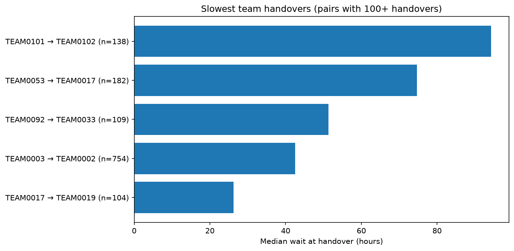

# Where do tickets stall? Handover analysis of an ITIL incident process

## Business question
Where do incidents lose time in the handling process, and which handovers
between teams and rework loops cause the most delay? The structure
(assignment, reassignment, updates, closure) mirrors cross-team handling of
engineering change requests in product development.

## Data
- Source: BPI Challenge 2014, Rabobank Group ICT, "Activity log for incidents"
  (4TU.ResearchData, DOI 10.4121/uuid:86977bac-f874-49cf-8337-80f26bf5d2ef)
- Size: 46,616 cases, 466,737 events, [X] teams, Jan 2013 to Apr 2014
- The raw file is not included in this repository. Download it from the link above.

## Approach
1. Built the event log (case ID, activity, timestamp, team)
2. Data quality checks and cleaning
3. Process discovery (Inductive Miner, directly-follows graph)
4. Variant analysis
5. Conformance checking against a self-defined normative model
6. Bottleneck and rework analysis

## Key findings
1. [Finding 1 with number]
2. [Finding 2 with number]
3. [Finding 3 with number]

## Recommendation
[One concrete recommendation]

## Data quality notes and limitations
- [Cleaning decisions with counts]
- The normative model is self-defined, not an official process model.
- [Sampling or filtering applied]

## How to run
1. `python3 -m venv venv && source venv/bin/activate`
2. `pip install -r requirements.txt`
3. Install Graphviz (`brew install graphviz` on Mac)
4. Download the dataset and place it in the project folder
5. Open `engineering_change_process_mining.ipynb` and run all cells